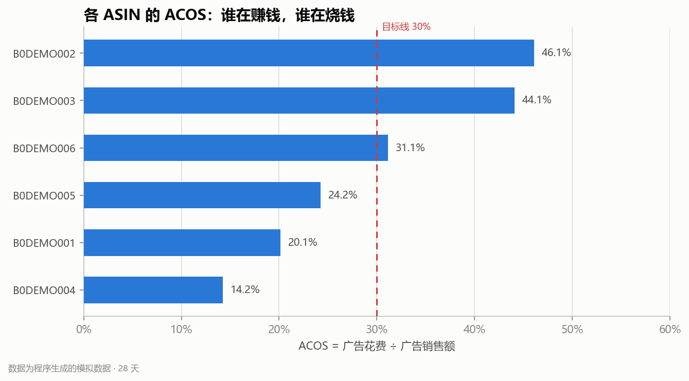

# 美区电商广告数据分析 Demo

用 **Python + pandas + numpy** 把销售、广告、关键词三张日报表清洗成可复核的指标，输出 ASIN / 关键词 / 周趋势结论、异常清单、Markdown / HTML 报告和 Excel 工作簿。

> **数据说明**：本项目全部使用程序生成的 **模拟数据**，不是真实店铺、真实品牌或真实平台导出数据。它用于演示“数据获取 → 清洗 → 分析 → 结论输出”的完整流程，不构成真实经营建议。

## 30 秒看结果

以 2026-10-01 至 2026-10-28 的 28 天模拟数据为例：

- 总销售额 **$86,121.52**，广告花费 **$8,830.48**，广告归因销售额 **$36,757.59**。
- 整体 **ACOS 24.0% / ROAS 4.16 / TACOS 10.3% / CVR 8.2%**。
- 值得加预算：**B0DEMO004**，ACOS 14.2%、ROAS 7.03、CVR 11.0%，贡献了店铺广告销售额的 31.2%。
- 需要降预算 / 查转化：**B0DEMO002**，ACOS 46.1%、花费 $1,697.70、CVR 5.4%。
- 先止损的关键词：**pet hair remover**，花费 $1,103.49、0 个归因订单。
- 需要人工复核的异常：**2026-10-17** 的 B0DEMO001 广告花费为同 ASIN 中位数的 **3.3 倍**，但归因订单为 0。



## 这个项目解决什么问题

跨境电商广告复盘常见三个问题：

1. 平台导出的表有重复、货币字符串、负数和缺失值，直接算指标会失真；
2. ACOS、TACOS、CVR 的分母不同，混着看容易得出错误结论；
3. 只报数不落到动作：哪个 ASIN 加预算、哪个关键词否词、哪条异常先查。

本项目把这三步串成一条可复现的流水线：

```text
data/raw/*.csv
      │
      ▼
校验 + 清洗（重复 / 日期 / 货币 / 负数 / 缺失 / 无效点击 / 未知 ASIN）
      │
      ▼
指标计算（ACOS / ROAS / TACOS / CVR / CTR / CPC / AOV）
      │
      ├── ASIN 汇总与预算建议
      ├── 广告活动汇总
      ├── 关键词动作（加预算 / 降价收词 / 加否词）
      ├── 周趋势
      └── 异常检测（花费尖峰、ACOS 偏高、CVR 环比下滑、零订单关键词）
      │
      ▼
reports/report.md + report.html + summary.xlsx + charts/*.png
```

## 快速开始

要求 Python 3.9+（本地在 Python 3.9.7 / pandas 1.3.4 / numpy 1.20.3 下验证，CI 使用 Python 3.11）。

```powershell
# 1. 安装依赖
python -m pip install -r requirements.txt

# 2. 生成可复现的模拟原始数据（固定随机种子）
python scripts/generate_sample_data.py

# 3. 跑完整分析流水线
python run.py

# 4. 跑测试
python -m pytest -q
```

打开 `reports/report.html` 可以直接看到完整可视化报告；`reports/report.md` 适合在 GitHub 上阅读；`reports/summary.xlsx` 是分 sheet 的复盘工作簿。

## 输出文件

| 文件 | 内容 |
| --- | --- |
| `reports/report.md` | 完整 Markdown 复盘报告，含结论、表格、异常和口径说明 |
| `reports/report.html` | 可直接在浏览器打开的排版版报告，含 KPI 卡和图表 |
| `reports/summary.xlsx` | 总览 / ASIN / 广告活动 / 关键词 / 周趋势 / 异常 / 数据质量 / 说明 |
| `reports/charts/acos_by_asin.png` | 各 ASIN ACOS 与 30% 目标线 |
| `reports/charts/spend_vs_sales.png` | 广告花费 vs 总销售额，气泡大小 = 广告订单 |
| `reports/charts/weekly_trend.png` | 周 CVR 与周 ACOS 小多图 |
| `data/processed/*.csv` | 清洗后的明细、ASIN/关键词汇总、周趋势、异常和清洗日志 |

## 数据字典

### `sales_daily.csv`（销售日报）

| 字段 | 含义 |
| --- | --- |
| `date` | 日期 |
| `asin` | 商品 ASIN（模拟） |
| `sku` | SKU（模拟） |
| `sessions` | 会话数 |
| `units_ordered` | 订单数 |
| `ordered_product_sales` | 销售额（美元） |
| `buy_box_percentage` | 购物车占有率 |
| `returns` | 退货数 |
| `currency` | 币种 |

### `ads_daily.csv`（广告日报）

| 字段 | 含义 |
| --- | --- |
| `date` / `asin` / `campaign` | 日期 / 商品 / 广告活动 |
| `impressions` | 曝光 |
| `clicks` | 点击 |
| `spend` | 广告花费（美元） |
| `attributed_sales` | 广告归因销售额 |
| `attributed_orders` | 广告归因订单 |

### `keyword_daily.csv`（关键词日报）

| 字段 | 含义 |
| --- | --- |
| `date` / `campaign` / `keyword` / `match_type` | 日期 / 活动 / 关键词 / 匹配方式 |
| `impressions` / `clicks` / `spend` | 曝光 / 点击 / 花费 |
| `attributed_sales` / `attributed_orders` | 归因销售额 / 归因订单 |

## 指标口径

| 指标 | 公式 | 用途 |
| --- | --- | --- |
| CTR | 点击 ÷ 曝光 | 广告素材 / 关键词吸引力 |
| CPC | 花费 ÷ 点击 | 单次点击成本 |
| CVR | 订单 ÷ 会话 | 店铺 / Listing 转化 |
| 广告 CVR | 广告订单 ÷ 广告点击 | 广告流量转化 |
| ACOS | 广告花费 ÷ 广告销售额 | 广告效率 |
| ROAS | 广告销售额 ÷ 广告花费 | ACOS 的倒数表达 |
| TACOS | 广告花费 ÷ 总销售额 | 广告对整体生意的负担 |
| AOV | 总销售额 ÷ 订单数 | 客单价 |

> ACOS 的分母是广告归因销售额，TACOS 的分母是总销售额，CVR 的分母是会话数。三者不能混着解释。

## 数据清洗规则

模拟原始数据里故意埋了这些脏数据，清洗时逐条记录处理方式：

| 问题 | 处理 |
| --- | --- |
| 日期格式混用（`2026-10-01` / `2026/10/12`） | 统一解析；无法解析的剔除 |
| ASIN 前后空格、小写 | 去空格 + 转大写 |
| 同日期 + ASIN 重复 | **先剔除无效行，再按业务键保留最后一条**，避免无效重复行把有效行顶掉 |
| `$1,234.50`、千分位、百分号、括号负数 | 统一转数值 |
| 销量 / 销售额 / 会话数为负 | 剔除并记录 |
| 会话数缺失 | 按同 ASIN 中位数填补 |
| 销量 / 销售额缺失 | 按 0 填补并记录 |
| 点击 > 曝光 | 剔除并记录 |
| 广告表中销售表不存在的 ASIN | 从广告分析中剔除，避免污染 ASIN 汇总 |
| 关键词归因订单缺失 | 按 0 填补并记录 |

本周期实际清洗结果：销售日报 169 → 166 行，广告日报 169 → 165 行，关键词日报 337 → 336 行。所有处理都写入 `reports/report.md` 的“数据质量”一节和 `data/processed/data_quality.csv`。

## 测试

```powershell
python -m pytest -q
# 9 passed
```

覆盖：

- 货币 / 括号负数解析
- 日期混用、ASIN 规范化、重复与缺失处理
- 点击大于曝光、未知 ASIN 剔除
- 整体指标与 ASIN 汇总
- 关键词零订单动作
- 空关键词表仍返回 `action` 列（兼容 pandas 2.x）
- 花费尖峰异常识别
- 标量分母的安全除法

## 目录结构

```text
ecom-analysis/
├─ run.py                       # 一键运行入口
├─ requirements.txt
├─ data/
│  ├─ raw/                      # 模拟原始 CSV
│  └─ processed/                # 清洗后的明细与汇总
├─ scripts/
│  └─ generate_sample_data.py   # 固定种子生成模拟数据 + 注入脏数据
├─ src/ecom_analysis/
│  ├─ cleaning.py               # 类型转换、去重、缺失处理、清洗日志
│  ├─ metrics.py                # 指标、维度汇总、异常检测
│  ├─ charts.py                 # matplotlib 图表
│  ├─ report.py                 # Markdown / HTML / Excel
│  └─ pipeline.py               # 流水线编排
├─ tests/                       # pytest
├─ reports/                     # 生成物
└─ .github/workflows/ci.yml     # CI：测试 + 全流程 + 产物检查
```

## 边界与说明

- 所有数据为模拟数据，**不是真实店铺数据**，也没有接入真实平台 API。
- 关键词“零订单”只代表当前归因窗口内没有订单，真实业务中要考虑归因延迟，建议回看 7–14 天。
- ACOS 高不一定立刻停投：新品、清库存、卡位等阶段可能有不同目标；本项目给出的是分析候选，不是自动执行指令。
- 项目重点是分析流程、口径纪律和可复核输出，不是预测模型；后续可以在此基础上接真实 API、做预算优化或时间序列预测。

## 面试演示路径（3 分钟）

1. 先打开 `reports/report.html`，用 30 秒讲清楚店铺整体 ACOS / ROAS / TACOS。
2. 指着 ASIN 表讲“为什么 B0DEMO004 加预算、B0DEMO002 降预算”，强调 ACOS 用的是广告归因销售额，不是总销售额。
3. 打开“数据质量”一节，讲一个具体 bug：如果先去重再校验，带无效点击的重复行可能把有效行顶掉；所以流水线是先剔除无效行，再按业务键去重。
4. 最后讲异常表：10/17 花费尖峰只代表“值得查”，不直接下结论，先核对归因延迟和广告后台。
