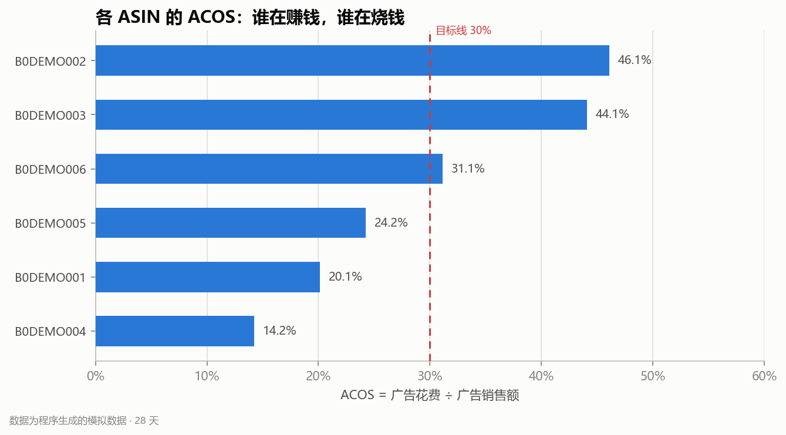
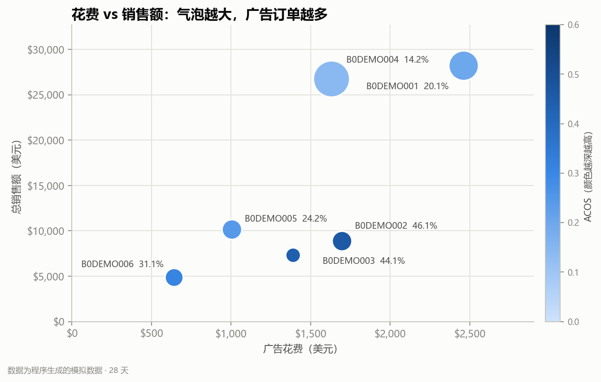
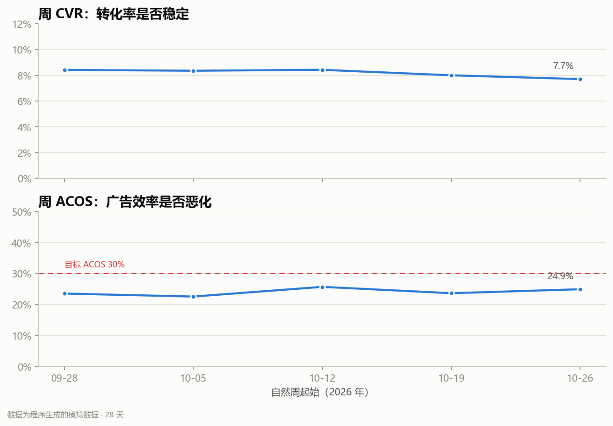

# 美区电商广告数据分析 Demo

> **数据说明**：本报告全部基于程序生成的模拟数据，不是真实店铺数据，也不代表任何真实品牌或平台。用途是演示完整的分析流程和可复核的结论。

**分析周期**：2026-10-01 至 2026-10-28（28 天）｜**ASIN**：6 个｜**生成时间**：2026-11-10 21:53

## 1. 一句话结论

本周期总销售额 **$86,121.52**，广告花费 **$8,830.48**，广告归因销售额 **$36,757.59**，整体 **ACOS 24.0% / ROAS 4.16 / TACOS 10.3% / CVR 8.2%**。

- 值得加预算：B0DEMO004，ACOS 14.2%、ROAS 7.03、CVR 11.0%，贡献了店铺广告销售额的 31.2%。建议先小步加预算 20%–30%，观察一周 ACOS 是否仍在可接受区间。
- 需要降预算 / 查转化：B0DEMO002，ACOS 46.1%、花费 $1,697.70、CVR 5.4%。先看搜索词和 Listing，再决定是降价、收词还是暂停。
- 先止损的关键词：pet hair remover，花费 $1,103.49、0 个归因订单。建议加入否词或改精准匹配；本周期共有 5 条异常/待复核记录。
- 最优先复核的异常：广告花费异常（B0DEMO001 / SP-Auto-Coffee，2026-10-17）。先核对广告后台与归因延迟；当天降预算，避免继续空烧。

> ACOS 用“广告花费 ÷ 广告归因销售额”，CVR 用“订单数 ÷ 会话数”，TACOS 用“广告花费 ÷ 总销售额”。三个指标口径不同，不能混着解释。

## 2. 核心指标

| 指标 | 数值 |
| --- | --- |
| 总销售额 | $86,121.52 |
| 广告花费 | $8,830.48 |
| ACOS | 24.0% |
| ROAS | 4.16 |
| CVR | 8.2% |
| TACOS | 10.3% |

补充：广告 CTR **5.5%**，CPC **$0.47**，广告 CVR **9.7%**，客单价 **$19.88**，广告销售额占总销售额 **42.7%**。

## 3. ASIN 表现

| ASIN | 销售额 | 广告花费 | ACOS | ROAS | CVR | 销售占比 | 建议 |
| --- | --- | --- | --- | --- | --- | --- | --- |
| B0DEMO001 | $28,199.15 | $2,461.80 | 20.1% | 4.97 | 9.6% | 32.7% | 维持观察 |
| B0DEMO004 | $26,735.28 | $1,631.64 | 14.2% | 7.03 | 11.0% | 31.0% | 加预算 |
| B0DEMO005 | $10,148.00 | $1,006.03 | 24.2% | 4.12 | 6.1% | 11.8% | 维持观察 |
| B0DEMO002 | $8,868.33 | $1,697.70 | 46.1% | 2.17 | 5.4% | 10.3% | 降预算，查 Listing |
| B0DEMO003 | $7,312.50 | $1,390.40 | 44.1% | 2.27 | 4.4% | 8.5% | 降预算，查 Listing |
| B0DEMO006 | $4,858.26 | $642.91 | 31.1% | 3.21 | 8.5% | 5.6% | 维持观察 |





## 4. 广告活动

| 广告活动 | ASIN | 花费 | 广告销售额 | ACOS | CTR | CPC | 花费占比 |
| --- | --- | --- | --- | --- | --- | --- | --- |
| SP-Auto-Coffee | B0DEMO001 | $2,461.80 | $12,241.29 | 20.1% | 5.5% | $0.58 | 27.9% |
| SP-Auto-Pet | B0DEMO002 | $1,697.70 | $3,684.06 | 46.1% | 6.1% | $0.55 | 19.2% |
| SBV-Silicone | B0DEMO004 | $1,631.64 | $11,464.83 | 14.2% | 4.6% | $0.30 | 18.5% |
| SP-Manual-Camping | B0DEMO003 | $1,390.40 | $3,152.50 | 44.1% | 6.9% | $0.75 | 15.7% |
| SP-Auto-Yoga | B0DEMO005 | $1,006.03 | $4,149.50 | 24.2% | 5.9% | $0.38 | 11.4% |
| SP-Auto-Stand | B0DEMO006 | $642.91 | $2,065.41 | 31.1% | 6.6% | $0.41 | 7.3% |

## 5. 关键词动作

| 关键词 | 广告活动 | 花费 | 订单 | ACOS | 广告 CVR | 动作 |
| --- | --- | --- | --- | --- | --- | --- |
| coffee filter cup | SP-Auto-Coffee | $1,402.19 | 268 | 19.9% | 11.0% | 加预算 |
| portable coffee maker | SP-Auto-Coffee | $1,120.32 | 225 | 19.4% | 11.3% | 加预算 |
| pet hair remover | SP-Auto-Pet | $1,103.49 | 0 | — | 0.0% | 加入否词 |
| silicone storage bag | SBV-Silicone | $897.40 | 396 | 14.2% | 13.3% | 加预算 |
| led camping light | SP-Manual-Camping | $748.96 | 43 | 57.6% | 4.1% | 降价 / 收词 |
| reusable food bag | SBV-Silicone | $734.24 | 321 | 14.2% | 13.2% | 加预算 |
| yoga stretching strap | SP-Auto-Yoga | $626.22 | 81 | 36.2% | 4.9% | 继续观察 |
| camping lantern rechargeable | SP-Manual-Camping | $612.77 | 57 | 31.4% | 6.6% | 继续观察 |
| pet brush for shedding | SP-Auto-Pet | $594.21 | 194 | 16.1% | 17.9% | 加预算 |
| stretch strap for flexibility | SP-Auto-Yoga | $417.44 | 120 | 16.1% | 10.9% | 加预算 |

> “加入否词”的规则是：本周期花费 ≥ $30 且归因订单为 0。这只是筛选候选，不是自动否定；落地前还要看搜索词和归因延迟。

## 6. 周趋势

| 周起始 | 总销售额 | 广告花费 | CVR | ACOS | ROAS |
| --- | --- | --- | --- | --- | --- |
| 2026-09-28 | $13,178.54 | $1,333.37 | 8.4% | 23.5% | 4.25 |
| 2026-10-05 | $19,669.60 | $1,951.48 | 8.4% | 22.6% | 4.43 |
| 2026-10-12 | $23,151.83 | $2,416.85 | 8.4% | 25.7% | 3.89 |
| 2026-10-19 | $21,588.56 | $2,204.96 | 8.0% | 23.6% | 4.23 |
| 2026-10-26 | $8,532.99 | $923.82 | 7.7% | 24.9% | 4.01 |

> 自然周以周日为周末，首尾周可能不完整。整体 CVR 稳定不代表每个 ASIN 都稳定，ASIN 级的 CVR 下滑见异常表。



## 7. 异常与待复核

| 类型 | 对象 | 日期/周期 | 指标 | 说明 | 建议 |
| --- | --- | --- | --- | --- | --- |
| 广告花费异常 | B0DEMO001 / SP-Auto-Coffee | 2026-10-17 | 花费 $276.80，订单 0 | 单日花费为同 ASIN 中位数的 3.3 倍，但没有归因订单 | 先核对广告后台与归因延迟；当天降预算，避免继续空烧 |
| ASIN ACOS 偏高 | B0DEMO002 | 本周期 28 天 | ACOS 46.1%，花费 $1,697.70 | CVR 5.4%，广告销售额 $3,684.06 | 降预算并检查关键词、价格、评分和 Listing 转化 |
| ASIN ACOS 偏高 | B0DEMO003 | 本周期 28 天 | ACOS 44.1%，花费 $1,390.40 | CVR 4.4%，广告销售额 $3,152.50 | 降预算并检查关键词、价格、评分和 Listing 转化 |
| CVR 环比下滑 | B0DEMO002 | 2026-10-19 起的一周 | 5.3% → 3.6% | 周 CVR 环比变化 -32% | 排查库存、价格、差评、配送时效和广告流量结构 |
| 关键词浪费 | pet hair remover | 本周期 28 天 | 花费 $1,103.49，订单 0 | 广告活动：SP-Auto-Pet，点击 2017 次 | 加入否词或转为精准匹配，先止损再测试 |

## 8. 数据质量

原始数据：销售日报 **169** 行，广告日报 **169** 行，关键词日报 **337** 行。清洗后保留销售 **166** 行、广告 **165** 行、关键词 **336** 行。

| 数据表 | 问题 | 行数 | 处理 |
| --- | --- | --- | --- |
| 销售日报 | 销量 / 销售额 / 会话数为负 | 1 | 删除该行 |
| 销售日报 | 同日期 + ASIN 重复 | 2 | 保留最后一条 |
| 销售日报 | 会话数缺失 | 1 | 按 ASIN 中位数填补 |
| 销售日报 | 销售额缺失 | 1 | 按 0 填补 |
| 广告日报 | 关键指标缺失 | 1 | 删除该行 |
| 广告日报 | 点击数大于曝光数 | 1 | 删除该行 |
| 广告日报 | 销售表中不存在的 ASIN | 1 | 从广告分析中剔除 |
| 广告日报 | 同日期 + ASIN + 活动重复 | 1 | 保留最后一条 |
| 关键词日报 | 归因订单缺失 | 1 | 按 0 填补 |
| 关键词日报 | 同日期 + 活动 + 关键词重复 | 1 | 保留最后一条 |

主要清洗规则：

- 日期兼容 `2026-10-01` 和 `2026/10/12`，无法解析的行剔除。
- ASIN 去空格并转大写；同日同 ASIN 重复保留最后一条。
- `$1,234.50`、千分位、百分号、括号负数统一转数值。
- 负数、点击大于曝光、关键指标缺失：剔除并记录。
- 会话数缺失：按同 ASIN 中位数填补；销量/销售额缺失：按 0 填补并记录。
- 广告表中销售表不存在的 ASIN：从广告分析中剔除，避免污染 ASIN 汇总。

## 9. 口径与限制

- 数据是 **28 天模拟数据**，没有真实平台 API、真实广告后台或真实财务口径。
- 总销售额来自销售表，广告销售额来自广告归因；两者天然存在归因差异。
- ACOS 高不一定立刻停投：新品、清库存、卡位等阶段可能有不同目标。
- 关键词“零订单”可能受归因延迟影响，落地前需回看 7–14 天。
- 本报告是分析练习，不构成真实经营建议。

## 10. 如何复现

```powershell
pip install -r requirements.txt
python scripts/generate_sample_data.py
python run.py
python -m pytest -q
```

生成文件：`reports/report.md`、`reports/report.html`、`reports/summary.xlsx`、`reports/charts/`。
